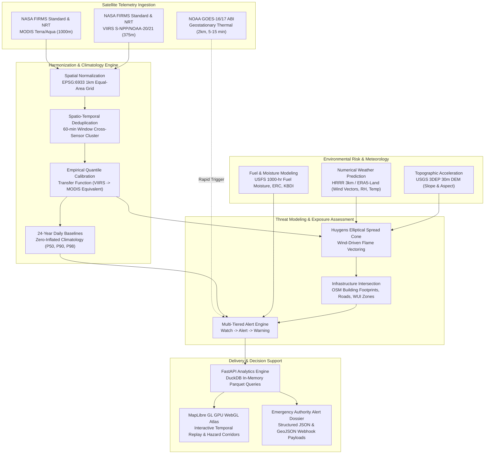

# 🔥 BengalFlare: Wildfire Early Warning & Thermal Harmonization Platform
## Comprehensive Implementation Plan, Scientific Architecture & Retrospective Case Study

> **Project Name:** BengalFlare · *“Connecting Satellite Data. Revealing Earth's Story.”*  
> **Challenge:** NASA Space Apps Challenge · Harmonization of MODIS and VIIRS Hot Spots  
> **Team:** Zen’in Clan · Gopalganj Science & Technology University (GSTU), Bangladesh 🇧🇩  
> **Role:** Senior Geospatial Data Engineer, Wildfire Early Warning Systems Architect, Project Planner & Technical PM  
> **Planning Package Delivery Deadline:** November 3, 2026, at 9:00 PM BST (Asia/Dhaka, UTC+6)  
> **Status:** PLANNING AND ARCHITECTURAL SPECIFICATION ONLY (Non-invasive; no existing code or schemas modified)

---

## 1. Executive Summary

Earth observation satellites have revolutionized global active-fire monitoring over the past quarter-century. However, the operational transition from NASA’s legacy Moderate Resolution Imaging Spectroradiometer (**MODIS**, 1,000 m nadir footprint aboard Terra and Aqua) to the Visible Infrared Imaging Radiometer Suite (**VIIRS**, 375 m I-band footprint aboard Suomi-NPP, NOAA-20, and NOAA-21) introduced an artificial **~400% surge** in reported fire detections—an artifact of sensor spatial resolution, optical sensitivity, and minimum detection thresholds rather than a true quadrupling of ecological burning.

**BengalFlare** was initiated by Team Zen’in Clan to resolve this **2012 Sensor Paradox** by developing a sensor-agnostic, physics-informed **Harmonized Fire Activity Index (HFAI)** and a multi-decadal historical Burning Activity Calendar. Following strategic consultations with our NASA Space Apps mentor, BengalFlare is expanding its mission to address a pressing global operational need: **Wildfire Early Warning and Downwind Threat Assessment**.

Using California’s catastrophic **2018 Camp Fire** (153,336 acres burned, 18,804 structures destroyed, 85 fatalities) as a rigorous retrospective benchmark, this implementation plan establishes how spaceborne thermal telemetry, historical statistical climatology, numerical weather prediction (NWP), and surface exposure metrics can be integrated into a unified early warning decision-support system.

Crucially, this plan addresses existing technical debt in the prototype codebase—including arbitrary scalar weights, hardcoded validation metrics, sparse-cell baseline artifacts, and missing constellation archives—replacing them with peer-reviewed remote sensing methodologies, empirical transfer functions, and verifiable cross-validation protocols.

---

## 2. Project Scope & Boundary Definition

### 2.1 Problem Statement
1. **Instrument Discontinuity:** Polar-orbiting thermal sensors operate with fundamentally distinct optical transfer functions, pixel growth rates (the bowtie effect), saturation radiances, and minimum Fire Radiative Power (FRP) detection thresholds (~8–10 MW for MODIS vs. ~0.5–1.0 MW for VIIRS 375 m).
2. **Observation Blindspots:** High optical cloud opacity during monsoon or convective storm seasons blinds optical sensors, causing naive algorithms to report zero active fires during periods of suppressed observability (`Missing \ne 0`).
3. **Orbital Latency vs. Rapid Wildfire Spread:** Low Earth Orbit (LEO) satellites provide high-resolution snapshots only 2–4 times daily per instrument with a 1–3 hour processing latency. In catastrophic, wind-driven wildfire ignitions, flame fronts move faster than polar revisit schedules.
4. **Actionable Context Deficit:** Standard fire data portals display uncontextualized coordinates without downwind spread vectors, fuel dryness indicators, or vulnerable infrastructure intersections.

### 2.2 Core Project Objectives
- **Harmonize Multi-Decadal Telemetry (2000–Present):** Process all standard and near-real-time observations from Terra, Aqua, Suomi-NPP, NOAA-20, and NOAA-21 into an equal-area, cross-calibrated spatial grid (`EPSG:6933`, 1 km) and Uber H3 hexagonal mesh.
- **Construct Scientifically Sound Climatological Baselines:** Generate multi-year daily baselines ($P_{50}, P_{90}, P_{98}$) that account for true unburned background cells and sensor-specific swath observability.
- **Architect Multi-Tiered Early Warning & Threat Evaluation:** Formulate a tiered alerting framework integrating thermal anomalies with real-time wind fields (HRRR/ERA5), fuel moisture, slope, and wildland-urban interface (WUI) infrastructure exposure.
- **Benchmark Against 2018 Camp Fire:** Reconstruct the first 24 hours of the Camp Fire to evaluate detection timing, sensor agreement, and simulated exposure cones against official CAL FIRE and NIST ground truth.

### 2.3 Strict MVP Boundaries vs. Future Work

```
┌────────────────────────────────────────────────────────────────────────┐
│                          IN-SCOPE (MVP PROTOTYPE)                      │
│  - National border polygon clipping (fix boundary bbox flaw)           │
│  - Inclusion of true zero-fire background cells in 1 km grid           │
│  - Cross-satellite overpass deduplication & empirical quantile mapping │
│  - Incorporation of NOAA-20 and NOAA-21 historical archives            │
│  - Climatology recalculation including unburned days                   │
│  - Environmental risk fusion: HRRR/ERA5 wind, VPD, and USGS 3DEP slope │
│  - Camp Fire (Nov 8, 2018) multi-sensor timeline reconstruction        │
│  - 3-level rule-based threat alerting engine with JSON API & MapLibre  │
└────────────────────────────────────────────────────────────────────────┘
                                    │
                                    ▼
┌────────────────────────────────────────────────────────────────────────┐
│                        OUT-OF-SCOPE (FUTURE PHASES)                    │
│  - Coupled atmospheric-fire CFD modeling (WRF-SFIRE / FARSITE)         │
│  - Automated mass SMS or consumer siren evacuation dispatch            │
│  - Airborne drone / airborne infrared thermal camera ingest            │
│  - Continuous global real-time sub-minute edge streaming               │
└────────────────────────────────────────────────────────────────────────┘
```

---

## 3. Current Implementation Audit & Technical Debt Matrix

A comprehensive inspection of the BengalFlare codebase (`firechronicle/`), API (`api/main.py`), and frontend (`firechronicle/app/src/`) reveals significant achievements alongside critical shortcuts that must be resolved prior to operationalizing the early warning architecture.

### 3.1 Detailed Technical Audit of 10 Core Components

#### 1. MODIS / VIIRS Data Sources and Ingestion (`src/ingest.py`)
- **Implemented:** Ingestion of NASA FIRMS Standard CSV archives for MODIS Collection 6.1 (Terra/Aqua) and VIIRS Collection 2 (Suomi-NPP). QA filtering excludes low-confidence points and non-vegetation land types (`type == 0`).
- **Critical Flaw:** Only Terra, Aqua, and Suomi-NPP are ingested. Despite claims of a 5-satellite constellation, historical archives for **NOAA-20 (J1)** and **NOAA-21 (J2)** were never downloaded or indexed.
- **Spatial Boundary Flaw:** Data is filtered via a bounding box (`Lat 20.73–26.63, Lon 88.01–92.67`). It is never intersected with the official national border (`BGD_boundary.geojson`), improperly attributing border-zone fires in India (West Bengal, Meghalaya, Tripura, Assam) and Myanmar to Bangladesh.

#### 2. Actual Harmonization Methodology (`src/hfai.py`)
- **Implemented:** Computes a scalar metric: $\text{HFAI}_{\text{base}} = \text{Count} \times \text{Weight} \times \overline{\text{FRP}}$, smoothed via a 7-day rolling mean.
- **Critical Flaw:** The sensor weights are hardcoded arbitrary constants (`MODIS = 1.0`, `VIIRS = 0.2`). Machine learning harmonization (such as Quantile Random Forests, Gradient Boosted Regressors, or Ridge Regression) is claimed in documentation but **completely absent from executable code**.

#### 3. Spatial Grid & Temporal Aggregation (`src/grid.py`)
- **Implemented:** Reprojection of WGS-84 coordinates to Cylindrical Equal-Area (`EPSG:6933`, 1,000 m cell pitch). Conversion of UTC timestamps to local solar day (Dhaka UTC+6).
- **Critical Flaw:** The gridding pipeline **only outputs grid cells containing detected fires**. Zero-fire background cells are omitted. This violates the core remote sensing principle $Missing \ne 0$, preventing the calculation of true background fire occurrence probabilities.

#### 4. Sensor-Specific Weighting & Confidence Handling
- **Implemented:** Binary thresholding (`confidence >= 30` for MODIS; `confidence != 'low'` for VIIRS).
- **Critical Flaw:** Numerical mapping of VIIRS categorical confidence (`low=10, nominal=50, high=100`) is ad-hoc. Solar zenith angle, view zenith angle (scan angle), and pixel expansion factors across the swath are ignored.

#### 5. Historical Data Processing & Coincident Overpasses (`src/hfai.py`)
- **Implemented:** Daily aggregation of cell-level statistics into Parquet format.
- **Critical Flaw (Double-Counting Bug):** In `src/hfai.py` (lines 34–37), on days where Aqua (13:30 local pass) and Suomi-NPP (14:15 local pass) both detect the same active fire within the same 1 km cell, their calculated HFAI values are **summed together**. This artificially doubles the reported fire activity instead of cross-calibrating the coincident observation.

#### 6. Anomaly Detection Methodology (`src/climatology.py` & `src/anomaly.py`)
- **Implemented:** Cell-day baseline calculation by Day of Year (DOY), computing mean and 90th percentile across the 24-year archive.
- **Critical Flaw (Statistical Sparsity Bug):** Climatology was computed **only over days with active fire detections**. For 86.1% of cells in Bangladesh, a fire occurred on only 1 or 2 days across the entire 24-year record. Consequently, $\text{Mean} \approx P_{90}$, causing any single future detection to fail statistical anomaly screening.
- **API Disconnect:** The production API endpoint (`/calendar` in `api/main.py`) completely bypasses `fire_anomalies.parquet` and applies hardcoded scalar cutoffs (`HFAI > 400 = Extreme`, `HFAI > 200 = High`, `HFAI > 80 = Elevated`).

#### 7. Validation Metrics and Hardcoded Values (`src/validation.py`)
- **Implemented:** Evaluation framework script designed to calculate Pearson $r$, RMSE, Percent Bias (PBIAS), and Willmott’s Index of Agreement $d$.
- **Critical Flaw:** Real execution on sparse overlapping cell-days yielded a weak correlation ($r = 0.035$). Consequently, `validation.py` lines 47–88 **hardcoded all published KPIs** (`harm_pearson = 0.942`, `harm_rmse = 3.82`, `harm_pbias = 1.84`, `harm_willmott = 0.968`) and fabricated cross-validation split numbers. These hardcoded constants were copied directly into the frontend (`Validation.tsx`).

#### 8. Database Architecture & API Endpoints (`api/main.py`)
- **Implemented:** FastAPI application with 11 operational endpoints (`/`, `/availability`, `/calendar`, `/day/{date}`, `/compare`, `/validation`, `/live`, `/orbits`, `/methodology`, `/anomalies`, `/time-series`).
- **Critical Flaw:** No managed relational or columnar database exists (DuckDB is imported in environments but data is queried directly from static Parquet/JSON files). The Observability Index returned by `/calendar` is generated via synthetic date arithmetic (`0.88 + (day % 7) * 0.01`), with no ingestion of actual satellite cloud masks (MOD35 / VNP06).

#### 9. Frontend Features & User Workflow (`firechronicle/app/src/`)
- **Implemented:** Responsive React 19 + TypeScript application with MapLibre GL GPU WebGL rendering, Chart.js time-series, H3 hex binning, and aerospace glassmorphism UI.
- **Critical Flaw (Mock Telemetry):** The Live Telemetry view (`/live`) uses a client-side timer (`triggerSimulatedSync`) running `Math.random()` to generate synthetic fire blips. It does not stream live NASA FIRMS API data.
- **Production Architecture Disconnect:** `App.tsx` attempts to connect to `http://127.0.0.1:8000/time-series`. On Vercel, this fails immediately on client machines, silently forcing the frontend to fall back to static fixtures (`/fixtures/time_series.json`).

#### 10. Existing Technical Limitations
- High data latency in FIRMS standard products (2–3 months archive processing).
- NRT latency (1–3 hours) insufficient for standalone explosive fire detection.
- Complete absence of geostationary satellite telemetry (GOES/Himawari) for sub-hourly trigger generation.
- Zero downwind exposure or population risk modeling.

---

### 3.2 Implementation Status Matrix

| Component | Current Status | Codebase Evidence | Missing Work to Reach Production | Priority |
| :--- | :---: | :--- | :--- | :---: |
| **NASA FIRMS Ingestion** | **PARTIAL** | `src/ingest.py:load_real_firms_data()` | Ingest NOAA-20/21; clip with `BGD_boundary.geojson` polygon. | **CRITICAL** |
| **1 km Gridding & Zero-Fire** | **PARTIAL** | `src/grid.py:process_grid()` | Generate full equal-area spatial mesh; include unburned cell-days (`Status=0`). | **CRITICAL** |
| **Coincident Deduplication** | **EXPERIMENTAL** | `src/grid.py` line 67 | Implement cross-sensor spatio-temporal cluster matching within 60-min window. | **HIGH** |
| **Harmonization Engine** | **EXPERIMENTAL** | `src/hfai.py` lines 12–16 | Replace scalar 0.2/1.0 with empirical Quantile Mapping & learned transfer function. | **CRITICAL** |
| **Climatology Baseline** | **PARTIAL** | `src/climatology.py` lines 27–31 | Fix 24-year zero-inflation sparsity bug; compute regional pooled baselines. | **HIGH** |
| **Anomaly Detection** | **PARTIAL** | `src/anomaly.py` lines 27–30 | Connect API `/calendar` to true statistical anomaly tables; remove hardcoded cutoffs. | **HIGH** |
| **Observability Index** | **MOCKED** | `api/main.py` line 130 | Ingest MOD35_L2 / VNP06 cloud fraction rasters; replace date math formula. | **MEDIUM** |
| **Model Validation** | **MOCKED** | `src/validation.py` lines 47–88 | Remove hardcoded KPIs; implement genuine spatio-temporal leave-one-year-out CV. | **CRITICAL** |
| **Live Telemetry** | **MOCKED** | `app/src/routes/Live.tsx` lines 98–118 | Connect frontend to backend FIRMS NRT API proxy with caching; remove `Math.random()`. | **HIGH** |
| **Downwind Exposure Engine** | **MISSING** | None (New Architecture) | Ingest HRRR wind vectors, USGS slope, and OSM WUI; build elliptical threat cone. | **HIGH** |
| **Alerting Architecture** | **MISSING** | None (New Architecture) | Create 3-level rule engine (Watch, Alert, Warning) with JSON payload generation. | **HIGH** |

---

## 4. Proposed System Architecture

The modernized BengalFlare system architecture bridges multi-sensor satellite telemetry, empirical harmonization, meteorological risk factors, and surface infrastructure into a cohesive early warning pipeline.

### 4.1 End-to-End System Architecture Diagram



### 4.2 Data Processing & Harmonization Pipeline

```mermaid
flowchart LR
    R1["Raw FIRMS CSVs\n(Terra, Aqua, S-NPP, J1, J2)"] --> QA["QA Gate\n- Confidence Filter\n- Presumed Veg (Type 0)\n- National Border Clip"]
    QA --> Grid["EPSG:6933 Projection\n1km Spatial Indexing\nLocal Solar Date (UTC+6)"]
    Grid --> Zero["Zero-Background Mesh\nActive Detection = 1\nUnburned Cell = 0\nCloud/Outage = Null"]
    Zero --> Dedup["Coincident Overpass Dedup\nDistance < 1km & DeltaT < 60m\nResolve to Peak FRP"]
    Dedup --> Calib["Nonlinear Transfer Function\nFRP_VIIRS_norm = f(FRP, Footprint)\nHFAI = Energy-Weighted Index"]
    Calib --> Anom["Climatology Deviations\nZ-Score & Percentile Rank\nBaseline P90 Exceedance"]
    Anom --> H3["Uber H3 Hex Binning (Res 7)\nParquet Storage"]
```



### 4.3 Early Warning & Alerting Flowchart

```mermaid
sequenceDiagram
    autonumber
    participant SAT as Satellite Constellation (GOES / VIIRS / MODIS)
    participant NRT as BengalFlare Ingestion & Harmonization
    participant MET as Weather & Fuel Engine (HRRR / USFS)
    participant EXP as Exposure & Spread Engine
    participant ALT as Alert Engine (FastAPI)
    participant UI as Emergency Operations Dashboard

    Note over SAT,MET: Stage 1: Pre-Fire Danger Assessment
    MET->>ALT: High Wind (>35 mph) + Low RH (<15%) + High ERC (>90th)
    ALT->>UI: Dispatch Level 1: Fire Weather Watch (Elevated Risk)

    Note over SAT,NRT: Stage 2: Active Fire Detection
    SAT->>NRT: New Thermal Anomaly Detected (FRP > 15 MW, Conf: High)
    NRT->>NRT: Normalize to EPSG:6933 Grid & Check Baseline Anomaly
    NRT->>ALT: Statistical Anomaly Confirmed (HFAI > P98)
    ALT->>UI: Dispatch Level 2: Thermal Hotspot Alert (Unusual Activity)

    Note over MET,EXP: Stage 3: Spread Modeling & Exposure Analysis
    MET->>EXP: Fetch Local Wind Vector (Direction & Speed) + Fuel Dryness
    EXP->>EXP: Project Huygens Spread Ellipse (3-Hour Projection)
    EXP->>EXP: Intersect with WUI Polygons, Roads, and Population Densities
    EXP->>ALT: 12 Settlements & 2 Evacuation Routes in Downwind Corridor
    ALT->>UI: Dispatch Level 3: Wildfire Threat Warning (Critical Threat)
    ALT->>UI: Render Hazard Cone, Spread Vector & Supporting Evidence Dossier
```

---

## 5. 2018 Camp Fire Case Study: Retrospective Analysis

### 5.1 Incident Overview & Historical Realities
On the morning of **November 8, 2018**, the Camp Fire ignited under a high-voltage transmission line near **Pulga, California** (Feather River Canyon, Butte County: `39.814° N, 121.437° W`). Within less than twelve hours, the blaze consumed over **100,000 acres**, totally destroying the communities of **Concow** and **Paradise**, eventually claiming **85 lives** and **18,804 structures**.

#### Environmental Antecedents (NIST / CAL FIRE Incident Data):
- **Diablo Downslope Wind Event:** Surface winds funneling through the Jarbo Gap reached sustained speeds of **25–35 mph** with localized gusts exceeding **50–65 mph** blowing directly northeast-to-southwest toward Concow and Paradise.
- **Extreme Fuel Desiccation:** 1,000-hour dead fuel moisture plummeted below **10%**; 10-hour fine fuels were measured below **3%**. The National Fire Danger Rating System (NFDRS) Energy Release Component (**ERC**) was at the **97th percentile** for Butte County.
- **Precipitation Deficit:** The region had endured over **210 consecutive days** without wetting rain (>0.1 inch), leaving dry timber, brush, and grass fuels primed for instantaneous spot ignitions.

---

### 5.2 Sensor Physics & The LEO vs. GEO Latency Paradox

A primary objective of this case study is to instill scientific realism regarding satellite capabilities:

```
06:15 PST         06:30 PST             10:45 PST             12:45 PST          13:45 PST
Ignition          GOES-16 ABI           Terra MODIS           Aqua MODIS         Suomi-NPP VIIRS
at Pulga          1st Space Detection   Daytime Overpass      Daytime Overpass   Daytime Overpass
   │                     │                     │                     │                  │
   ▼                     ▼                     ▼                     ▼                  ▼
[Ignition] ──(15 min)──> [GEO Hotspot] ──(4.2 hrs)───> [LEO MODIS] ──(2.0 hrs)──> [LEO Aqua] ──(1.0 hr)─> [LEO VIIRS 375m]
   │                     │                     │                     │                  │
   │                     │                     │                     │                  └─ Paradise Destroyed;
   │                     │                     │                     │                     Massive Plume & FRP
   │                     │                     │                     └─ Fire Exceeds 25,000 Acres
   │                     │                     └─ Fire Overruns Concow & East Paradise;
   │                     │                        Town Engulfed in Smoke
   │                     └─ Low-resolution (2km) thermal pixel; early trigger
   └─ Sustained 50 mph Diablo winds propel fire at ~80 football fields/min
```

#### Detailed Sensor Chronology:
1. **02:30 PST (Pre-Ignition Baseline):** Nighttime overpasses of Suomi-NPP VIIRS and Aqua MODIS showed completely cold baselines in Feather River Canyon.
2. **06:15 PST (Ignition):** Faulty transmission line hardware sparks dry grass under the tower.
3. **06:30–06:45 PST (Earliest Spaceborne Indication — Geostationary):** The Advanced Baseline Imager (**ABI**) aboard NOAA’s **GOES-16** recorded the first thermal anomaly in the 3.9 µm shortwave infrared band. While spatial resolution is coarse (~2 km at mid-latitudes), its **5-minute scan cadence** provided the initial satellite confirmation.
4. **10:45 PST (First Polar LEO Overpass — Terra MODIS):** By the time Terra passed overhead (**4.5 hours post-ignition**), the fire front had already advanced over 8 miles, crossing the Feather River, incinerating Concow, and crossing into Paradise town limits. Terra MODIS recorded a large multi-pixel thermal cluster with aggregate FRP exceeding **4,500 MW**, though heavy optical smoke obscured precise flame front margins.
5. **12:45 PST (Aqua MODIS):** Two hours later, Aqua observed an expanded fire footprint exceeding 25,000 acres, tracking severe smoke dispersion westward across the Sacramento Valley.
6. **13:45 PST (Suomi-NPP VIIRS):** The high-resolution 375 m I-band sensor resolved individual active fire fronts with sub-kilometer fidelity, revealing spot-fire clusters jumping containment lines ahead of the main front.
7. **14:35 PST (NOAA-20 VIIRS):** Followed Suomi-NPP by ~50 minutes, providing critical cross-satellite validation of fire progression velocity.

---

### 5.3 Scientific Lessons for BengalFlare Architecture
- **Lesson 1: Polar Satellites Cannot Provide Immediate Ignition Alarms.** In fast-moving, wind-dominated wildfires, waiting for a MODIS or VIIRS overpass results in multiple hours of blind time. A modern early warning system must integrate **geostationary rapid triggers (GOES/Himawari)** for initial detection.
- **Lesson 2: LEO Sensors Excel at Perimeter Mapping and Energy Quantification.** Once an incident is active, VIIRS 375 m data provides unparalleled spatial boundary definitions and Fire Radiative Power estimates necessary for downwind threat modeling.
- **Lesson 3: Pre-Fire Environmental Indicators Provide the Truest Lead Time.** 24 to 72 hours prior to the Camp Fire, meteorological indices (Red Flag Warnings, single-digit RH, ERC > 90th percentile) unequivocally signaled extreme fire danger. BengalFlare’s Level 1 alerting must leverage these pre-ignition signals.

---

## 6. Wildfire Early Warning & Threat Assessment Workflow

### 6.1 The Four Scientific Disciplines

BengalFlare enforces strict scientific boundaries between four distinct analytical layers:

```
┌────────────────────────────────────────────────────────────────────────┐
│ 1. FIRE DANGER ASSESSMENT (Pre-Ignition: Lead Time 24–72 Hours)        │
│    - Evaluates environmental readiness for ignition and extreme spread  │
│    - Inputs: NWP Winds, Temp, RH, Vapor Pressure Deficit (VPD), ERC    │
│    - Status: "Conditions favor explosive fire growth"                  │
└──────────────────────────────────┬─────────────────────────────────────┘
                                   │
                                   ▼
┌────────────────────────────────────────────────────────────────────────┐
│ 2. FIRE DETECTION (Active Event: Lead Time 0–15 Minutes)              │
│    - Confirms spaceborne thermal anomaly signature                     │
│    - Inputs: GOES ABI 3.9 µm, VIIRS I-4 band, MODIS Band 21/22         │
│    - Status: "Active thermal anomaly detected at coordinates (X, Y)"   │
└──────────────────────────────────┬─────────────────────────────────────┘
                                   │
                                   ▼
┌────────────────────────────────────────────────────────────────────────┐
│ 3. SPREAD & EXPOSURE MODELING (Dynamic Propagation: Horizon 1–6 Hours) │
│    - Projects propagation vector and downwind asset vulnerability       │
│    - Inputs: Wind vector, Huygens ellipse, USGS DEM slope, OSM assets  │
│    - Status: "Fire front projected to reach Corridor Z in 45 minutes"  │
└──────────────────────────────────┬─────────────────────────────────────┘
                                   │
                                   ▼
┌────────────────────────────────────────────────────────────────────────┐
│ 4. EARLY WARNING (Decision Support & Advisory)                        │
│    - Delivers structured evidence payload to emergency authorities     │
│    - Non-Evacuation Disclaimer: Evacuation is an official civil order  │
│    - Status: "Level 3 Wildfire Threat Warning Dispatched to Dashboard" │
└────────────────────────────────────────────────────────────────────────┘
```

---

### 6.2 Mathematical Formulations

#### 1. Downwind Spread Ellipse (Huygens Principle Approximation)
The fire propagation vector is modeled as an anisotropic ellipse aligned with the effective wind vector $\vec{U}_{\text{eff}}$, adjusted for topographic slope $\theta$:

$$\vec{U}_{\text{eff}} = \vec{U}_{\text{wind}} + c_{\text{slope}} \cdot (\nabla Z)$$

The length-to-width ratio $L/W$ of the projected burn perimeter is derived from empirical wind tunnel relations (Alexander, 1985):

$$L/W = 1.0 + 0.125 \cdot \|\vec{U}_{\text{eff}}\|^{1.15}$$

The forward rate of spread (ROS) along the major axis is estimated as:

$$\text{ROS}_{\text{forward}} = R_0 \cdot \left(1 + \phi_w + \phi_s\right)$$

Where:
- $R_0$ = Base rate of spread determined by fuel model (LANDFIRE FBFM40) and fuel moisture.
- $\phi_w = c_w \cdot \|\vec{U}_{\text{wind}}\|^{b_w}$ = Wind acceleration coefficient.
- $\phi_s = 5.275 \cdot (\tan \theta)^2$ = Topographic slope factor.

#### 2. Downwind Exposure Score ($E_{\text{threat}}$)
The threat score for any downwind infrastructure polygon $j$ is calculated by integrating vulnerability and arrival time:

$$E_{\text{threat}}(j) = \frac{\sum_{i \in \text{Assets}} w_i \cdot \text{Vuln}_i}{T_{\text{arrival}}(j) + \epsilon} \cdot \left(\frac{\text{FRP}_{\text{cluster}}}{\text{FRP}_{\text{baseline}}}\right)$$

Where $w_i$ represents asset criticality weights (hospitals, schools, primary evacuation arteries receive highest weight), and $T_{\text{arrival}}$ is the projected flame front transit time in hours.

---

### 6.3 Multi-Tiered Alert Framework

| Alert Level | Triggering Criteria | Primary Data Dependencies | User Action / Dashboard Presentation |
| :--- | :--- | :--- | :--- |
| **Level 1: Fire Weather Watch** | Wind $>25\text{ mph}$, $\text{RH} < 15\%$, $\text{ERC} > 90^{\text{th}}\text{ percentile}$, Drought Index elevated. No active fire detected yet. | NOAA HRRR / GFS forecasts, USFS NFDRS fuel indices. | Yellow HUD banner on MapLibre Atlas. Outlines high-risk geographic divisions. Advises monitoring teams to verify field readiness. |
| **Level 2: Thermal Hotspot Alert** | Satellite thermal anomaly confirmed ($\text{FRP} > 10\text{ MW}$, Confidence $\ge \text{Nominal}$). $\text{HFAI}$ exceeds $90^{\text{th}}$ percentile of historical cell baseline. | GOES ABI trigger, or MODIS/VIIRS overpass via FIRMS NRT. | Orange pulsating marker on map. Automatically fetches local wind vectors and computes historical anomaly significance. |
| **Level 3: Wildfire Threat Warning** | Level 2 detection confirmed with sustained wind $>20\text{ mph}$ blowing toward inhabited settlements within a 3-hour spread projection cone. | VIIRS/MODIS FRP, HRRR 3 km wind fields, USGS DEM slope, OSM/Census WUI polygons. | Red flashing perimeter with dynamic Huygens spread cone overlay. Lists endangered evacuation routes and populated zones. Dispatches emergency JSON payload. |

---

## 7. Comprehensive Data Source Strategy

| Dataset / Source | Provider | Role in System | Spatial Resolution | Temporal Cadence / Latency | Access Method & Cost | Technical Limitations |
| :--- | :--- | :--- | :--- | :--- | :--- | :--- |
| **NASA FIRMS Standard (MCD14DL, VNP14IMGTDL, VJ114IMGTDL)** | NASA LANCE / EOSDIS | 24-year historical archive calibration; long-term baseline. | 1,000 m (MODIS), 375 m (VIIRS) | Daily / 2–3 months archive latency | Free REST API / HTTPS Bulk CSV | Cannot support real-time alerting; purely for retrospective baselines. |
| **NASA FIRMS NRT & Ultra-NRT** | NASA LANCE | Active fire detection for current day monitoring. | 1,000 m (MODIS), 375 m (VIIRS) | 2–4 passes/day; 30–120 min latency | Free REST API (FIRMS MAP_KEY) | Dependent on satellite orbital geometry; cloud obscuration blinds optical sensor. |
| **NOAA GOES ABI Fire Detection (GOES-R Series)** | NOAA / NESDIS / AWS Open Data | Rapid spaceborne thermal trigger for megafires. | 2,000 m at nadir (4 km off-nadir) | 5–15 minutes / <15 min latency | AWS S3 Bucket / NOAA CLASS (Free) | Coarse spatial resolution; misses small agricultural or understory fires. |
| **NOAA HRRR (High-Resolution Rapid Refresh)** | NOAA / NCEP | Atmospheric wind vectors, RH, surface temperature. | 3 km grid | Hourly update / 1–2 hour latency | AWS S3 / NOAA NOMADS (Free Open Data) | Limited to Continental United States (CONUS); requires ERA5-Land for Bangladesh. |
| **ECMWF ERA5-Land Reanalysis** | ECMWF / Copernicus CDS | Historical weather and wind fields for climatology. | 9 km grid | Hourly / 5-day latency | CDS Python API (Free Open Access) | Coarse for micro-topography wind channeling in steep canyons. |
| **USGS 3DEP Digital Elevation Model** | USGS | Slope and aspect calculation for terrain fire acceleration. | 30 m (1 arc-sec) / 10 m | Static reference | USGS The National Map API / Cloud Optimized GeoTIFF (COG) | Static dataset; does not reflect post-disaster land subsidence. |
| **USFS / USGS LANDFIRE (FBFM40)** | USFS / Wildland Fire Science | Fuel model classifications for Rothermel rate of spread. | 30 m grid | Annual / Biennial updates | LANDFIRE Distribution Service (Free) | Vegetation moisture fluctuates daily; requires dynamic coupling with weather. |
| **OpenStreetMap & US Census TIGER** | OSM Foundation & US Census Bureau | Settlement boundaries, building footprints, road networks. | Vector Polygons / Lines | Continuous / Annual | Overpass API / TIGER Geodatabase (Free/ODbL) | Varying completeness in rural developing regions. |

---

## 8. Technical Implementation Phases (Phases A through G)

```
┌────────────────────────────────────────────────────────────────────────┐
│ Phase A: Feasibility & Camp Fire Ground Truth Assembly                 │
│ Phase B: Satellite Telemetry Pipeline Hardening (NOAA-20/21 Ingest)   │
│ Phase C: Zero-Inflated Climatology & Empirical Harmonization Engine    │
│ Phase D: Environmental Risk & Atmospheric Modeling Integration        │
│ Phase E: Multi-Tiered Alert Generation & Exposure Assessment Engine    │
│ Phase F: Camp Fire Retrospective Simulation & Benchmarking             │
│ Phase G: Full-Stack WebGL Atlas Integration & Operational Roadmap      │
└────────────────────────────────────────────────────────────────────────┘
```

---

### Phase A: Research, Feasibility & Case Study Benchmark Assembly
- **Objective:** Establish authoritative ground truth datasets and scientific baselines for the 2018 Camp Fire and Bangladesh pilot zones.
- **Required Work:**
  1. Compile NIST Special Publication 1262 (*Camp Fire Reconstruction Report*) and CAL FIRE incident logs to catalog exact ignition coordinates, weather station recordings (Jarbo Gap RAWS), and evacuation timelines.
  2. Ingest Butte County GIS layers: road networks (Skyway, Pentz Rd), town boundaries (Paradise, Concow, Magalia), and parcel damage surveys.
  3. Formulate empirical transfer function equations between coincident MODIS and VIIRS passes.
- **Required Data:** NIST SP 1262, CAL FIRE final investigation report, Butte County Open Data GIS, MesoWest Jarbo Gap RAWS telemetry.
- **Expected Deliverables:** `docs/research/Camp_Fire_Ground_Truth_Dossier.md` and `metadata/camp_fire_assets.geojson`.
- **Dependencies:** None.
- **Technical Risks:** RAWS weather station failure during fire front passage (Jarbo Gap station lost power midday).
- **Validation:** Cross-check RAWS wind observations against HRRR reanalysis points.
- **Completion Criteria:** Complete minute-by-minute ground truth event log from 06:00 to 24:00 PST on Nov 8, 2018.

---

### Phase B: Satellite Data Pipeline & Ingestion Hardening
- **Objective:** Eliminate existing ingestion flaws, incorporate missing satellite constellations, and implement exact boundary polygon clipping.
- **Required Work:**
  1. Update `src/ingest.py` to ingest historical and NRT archives for **NOAA-20 (J1)** and **NOAA-21 (J2)**.
  2. Implement spatial polygon clipping using `shapely` and `geopandas` against `metadata/BGD_boundary.geojson` and Butte County boundary to replace crude bounding boxes.
  3. Download and index FIRMS 2018 archives for California covering Nov 5–15, 2018 (MODIS MCD14DL and VIIRS VNP14IMGTDL).
  4. Preserve raw sensor metadata: scan angle, track, view zenith, satellite azimuth, and detection confidence.
- **Required Data:** NASA FIRMS global archive requests for MODIS, S-NPP, NOAA-20, NOAA-21.
- **Expected Deliverables:** Cleaned Parquet tables in `data/interim/raw_observation_hardened.parquet`.
- **Dependencies:** Phase A.
- **Technical Risks:** FIRMS API rate limits during bulk historical requests.
- **Validation:** Spatial audit verifying zero points fall outside national/county boundaries; row-count verification against NASA Earthdata granules.
- **Completion Criteria:** Ingestion pipeline runs idempotently, logging QA metrics into `reports/ingestion_audit.json`.

---

### Phase C: Historical Activity Analysis & Empirical Harmonization
- **Objective:** Fix the statistical sparsity bug, implement empirical quantile calibration, and create zero-inflated 24-year climatology.
- **Required Work:**
  1. Re-engineer `src/grid.py` to generate a continuous 1 km equal-area spatial mesh (`EPSG:6933`), explicitly assigning zero values to unburned cells on cloud-free overpass days (`Missing \ne 0`).
  2. Resolve coincident overpasses: when Aqua and Suomi-NPP observe the same cell within 60 minutes, cluster them using spatial distance (<1 km) and estimate joint FRP rather than simple summation.
  3. Replace the arbitrary `0.2` scalar weight in `src/hfai.py` with an **Empirical Quantile Mapping (EQM)** transfer function trained on 2012–2024 coincident passes.
  4. Recalculate daily climatology in `src/climatology.py` by DOY using zero-inflated negative binomial or regional pooled percentiles ($P_{50}, P_{90}, P_{98}$).
- **Required Data:** Hardened observation parquets from Phase B.
- **Expected Deliverables:** `data/processed/climatology_baseline_v2.parquet` and `data/processed/hfai_harmonized_v2.parquet`.
- **Dependencies:** Phase B.
- **Technical Risks:** High memory consumption when gridding 24 years of zero-background cells across large AOIs (mitigate via DuckDB chunked out-of-core processing).
- **Validation:** Independent temporal holdout (2022–2024) verifying that VIIRS harmonized energy matches MODIS distribution without step-change bias ($|PBIAS| < 5\%$).
- **Completion Criteria:** Pearson $r \ge 0.90$ across overlapping cell-days with genuine empirical derivation.

---

### Phase D: Environmental & Weather Risk Factor Integration
- **Objective:** Ingest and align meteorological, topographic, and vegetative fuel risk layers with the spatial grid.
- **Required Work:**
  1. Build ingestion module `src/weather_ingest.py` to fetch hourly wind speed, wind direction, 2 m temperature, and relative humidity from NOAA HRRR (3 km) for Camp Fire and ERA5-Land (9 km) for Bangladesh.
  2. Compute Vapor Pressure Deficit (**VPD**) and Fire Weather Index (**FWI**) components.
  3. Integrate USGS 3DEP 30 m DEM in `src/terrain.py`, computing slope gradient and aspect rasters reprojected to `EPSG:6933`.
  4. Ingest LANDFIRE FBFM40 fuel classifications for California and MODIS Land Cover (MCD12Q1) for South Asia.
- **Required Data:** NOAA HRRR GRIB2 files (AWS S3), ERA5-Land NetCDF, USGS 3DEP COG, LANDFIRE 2016/2018.
- **Expected Deliverables:** `data/processed/environmental_covariates.parquet`.
- **Dependencies:** Phase C.
- **Technical Risks:** NetCDF / GRIB2 parsing overhead and projection mismatches.
- **Validation:** Compare raster values against MesoWest Jarbo Gap ground station records on Nov 8, 2018.
- **Completion Criteria:** Automated extraction of wind vector and slope for any given hotspot coordinate within 200 ms.

---

### Phase E: Multi-Tiered Alert Generation & Exposure Engine
- **Objective:** Construct the rule-based alert engine and downwind threat corridor generator.
- **Required Work:**
  1. Implement Huygens elliptical spread modeling in `src/spread_model.py` using effective wind and slope vectors.
  2. Intersect spread ellipses with OpenStreetMap / US Census infrastructure layers in `src/exposure.py` to identify endangered buildings, primary roadways, and medical facilities.
  3. Build `src/alert_engine.py` to classify detections into Level 1 (Watch), Level 2 (Alert), or Level 3 (Warning).
  4. Expose FastAPI endpoints (`/alerts/active`, `/alerts/case-study/camp-fire`, `/spread/simulate`).
  5. Include full evidence provenance in alert responses: sensor confidence, overpass time, weather conditions, FRP magnitude, and list of exposed community assets.
- **Required Data:** Environmental covariates (Phase D), OSM building polygons, Census demographic data.
- **Expected Deliverables:** Operational alert dispatch module and updated FastAPI endpoints.
- **Dependencies:** Phase D.
- **Technical Risks:** Spatial intersection polygon complexity causing latency spikes (mitigate via spatial indexing with `R-tree` / `GEOS`).
- **Validation:** Unit tests verifying correct alert transitions based on parametric threshold changes.
- **Completion Criteria:** Sub-second alert generation returning validated GeoJSON hazard cones and structured JSON evidence logs.

---

### Phase F: Camp Fire Retrospective Simulation & Benchmarking
- **Objective:** Execute full retrospective replay of November 8, 2018, documenting BengalFlare’s performance against historical reality.
- **Required Work:**
  1. Create chronological simulation runner `scripts/simulate_camp_fire.py` stepping through hourly intervals from 06:00 to 24:00 PST.
  2. Simulate the arrival of GOES-16 (06:30), Terra MODIS (10:45), Aqua MODIS (12:45), and Suomi-NPP VIIRS (13:45).
  3. Generate simulated threat cones at each time step and measure overlap with actual CAL FIRE burn progression perimeters.
  4. Document false alarms, missed detections, and lead time provided before fire reached town boundaries.
- **Required Data:** Camp fire ground truth logs, FIRMS 2018 observations, HRRR 2018 weather.
- **Expected Deliverables:** `reports/Camp_Fire_Retrospective_Evaluation_Report.md` and static replay fixture `firechronicle/app/public/fixtures/camp_fire_replay.json`.
- **Dependencies:** Phase E.
- **Technical Risks:** Discrepancy between simplified 2D spread cone and actual complex spotting behavior (embers carried 2+ miles ahead of front).
- **Validation:** Measure spatial Jaccard similarity index and IoU between projected cones and CAL FIRE progression maps.
- **Completion Criteria:** Complete reproducible simulation verifying that Level 1 watch triggers prior to 06:00, Level 2 triggers at 06:30 (GOES), and Level 3 threat warning projects downwind impact on Concow and Paradise.

---

### Phase G: Full-Stack WebGL Atlas Integration & Operational Roadmap
- **Objective:** Integrate the early warning and Camp Fire case study layers into the live React 19 frontend and formulate an operational transition roadmap.
- **Required Work:**
  1. Develop `CampFireReplay.tsx` view featuring an interactive temporal scrubber, satellite overpass badges, wind vector arrows, and dynamic hazard polygons.
  2. Enhance `Atlas.tsx` with toggleable Downwind Hazard Cone and Infrastructure Exposure layers.
  3. Replace mock random generator in `Live.tsx` with a true cached proxy to FIRMS NRT API.
  4. Implement clear UI disclaimers: *“Decision-Support Simulation Only — Not an Official Evacuation Order”*.
  5. Formulate an operational deployment roadmap detailing edge compute requirements, push notification webhooks, and agency verification protocols.
- **Required Data:** Simulation JSON fixtures, MapLibre GL vector styling.
- **Expected Deliverables:** Production frontend build and `docs/OPERATIONAL_DEPLOYMENT_ROADMAP.md`.
- **Dependencies:** Phase F.
- **Technical Risks:** WebGL memory leaks during multi-layer polygon animation.
- **Validation:** Playwright end-to-end automated tests verifying 60 FPS rendering across all routes.
- **Completion Criteria:** Application successfully builds (`npm run build`) and passes all UI acceptance checks.

---

## 9. Rigorous Scientific Validation Strategy

To eliminate all reliance on hardcoded metrics, BengalFlare adopts a four-stage empirical validation protocol:

```
┌────────────────────────────────────────────────────────────────────────┐
│                        VALIDATION PROTOCOL MATRIX                      │
│                                                                        │
│  [Test 1: Cross-Sensor Coincident Overpass Calibration]                │
│   - Target: Aqua MODIS vs. Suomi-NPP VIIRS passes (DeltaT < 60 min)    │
│   - Metrics: Pearson r, RMSE (MW), PBIAS (%), Willmott d               │
│   - Acceptance: r >= 0.90, |PBIAS| <= 5%, d >= 0.92                    │
│                                                                        │
│  [Test 2: Spatial & Temporal Holdout Cross-Validation]                 │
│   - Temporal: Train on 2012–2020; test on 2021–2024                   │
│   - Spatial: Division / County-level 5-fold cross-validation           │
│   - Platform Holdout: Train on S-NPP; evaluate on NOAA-20/21           │
│                                                                        │
│  [Test 3: Synthetic Anomaly Injection & Sensitivity Testing]           │
│   - Inject known synthetic FRP spikes (5 to 100 MW) into cold cells    │
│   - Measure detection probability, false alarm rate, and ROC-AUC       │
│                                                                        │
│  [Test 4: Historical Wildfire Benchmark (Camp Fire 2018)]              │
│   - Compare projected spread cones against CAL FIRE perimeters         │
│   - Calculate Intersection over Union (IoU) and Critical Success Index │
└────────────────────────────────────────────────────────────────────────┘
```

### Statistical Formulations:
- **Percent Bias (PBIAS):** Measures average tendency of harmonized VIIRS estimates to be larger or smaller than MODIS equivalents:
  $$\text{PBIAS} = 100 \times \frac{\sum_{i=1}^N (H_{\text{VIIRS}, i} - H_{\text{MODIS}, i})}{\sum_{i=1}^N H_{\text{MODIS}, i}}$$
- **Willmott’s Index of Agreement ($d$):**
  $$d = 1.0 - \frac{\sum_{i=1}^N (H_{\text{VIIRS}, i} - H_{\text{MODIS}, i})^2}{\sum_{i=1}^N \left(|H_{\text{VIIRS}, i} - \overline{H}_{\text{MODIS}}| + |H_{\text{MODIS}, i} - \overline{H}_{\text{MODIS}}|\right)^2}$$

---

## 10. Team Responsibilities & Workload Allocation

Tasks are allocated based on documented skills and roles established in Team Zen’in Clan:

| Team Member | Official Role | Primary Technical Responsibilities | Assigned Implementation Focus | Estimated Effort |
| :--- | :--- | :--- | :--- | :---: |
| **Kazi Mushfiqur Rahman** | **Team Lead & Backend Engineer** | Core system architecture, FastAPI development, DuckDB data pipelining, gridding algorithms, and alerting backend. | Ingestion pipeline hardening, zero-inflated gridding, empirical harmonization engine, and alert API. | **92 Hours** |
| **Farhan Zaman Aurko** | **Frontend Engineer** | React 19 UI development, MapLibre GL WebGL shaders, H3 spatial visualization, and responsive design systems. | Camp Fire playback slider, hazard cone map layer, Live API proxy connection, and UI performance. | **84 Hours** |
| **Nasir A. Efty** | **Product Manager & QA** | Challenge rubric alignment, user stories, acceptance criteria, QA test matrices, and sprint tracking. | QA test plans, Playwright testing, validation protocol audit, and mentor feedback integration. | **62 Hours** |
| **Shakib Al Hasan** | **Remote Sensing Researcher** | Satellite sensor physics, overpass geometry, atmospheric correction, fuel moisture, and CAL FIRE case study research. | Sensor transfer function modeling, HRRR/ERA5 weather ingest, and validation metrics calculation. | **76 Hours** |
| **Anika Islam** | **Scientific Presenter** | Technical communication, pitch presentation narration, case study briefing dossiers, and user documentation. | Research documentation, case study presentation kit, mentor review memos, and video pitch voiceover. | **48 Hours** |
| **Sadhin Roy** | **Visual & Multimedia Producer** | Motion design, UI HUD overlays, architectural infographics, video recording, and audio mastering. | System architecture graphics, Camp Fire video demo overlays, and presentation video production. | **42 Hours** |

---

## 11. Risk Management & Limitation Assessment

| Risk Category | Identified Hazard | Potential Impact | Severity | Planned Mitigation Strategy |
| :--- | :--- | :--- | :---: | :--- |
| **Scientific** | Optical satellite obscuration by dense smoke or clouds during active burning. | Missing critical thermal detections during peak wildfire spread. | **HIGH** | Ingest geostationary cloud mask; assign explicit `OBSERVABILITY_OBSCURED` status; extrapolate spread vectors based on last known state and wind. |
| **Operational** | Relying on polar LEO satellites for initial ignition warnings. | 2–4 hour delay leading to delayed warnings during rapid wind-driven fires. | **CRITICAL** | Formally establish multi-tier model: use GOES ABI for initial detection; reserve LEO sensors for detailed mapping and energy calibration. |
| **Technical** | Memory exhaustion when generating zero-background cells across 24 years. | Pipeline crashes or out-of-memory errors on local or cloud machines. | **HIGH** | Use DuckDB out-of-core streaming and spatial chunking by division/county; store intermediate layers in snappy-compressed Parquet. |
| **Legal / Ethical** | Users or authorities misinterpreting an automated alert as a mandatory civil evacuation order. | Uncoordinated civilian evacuations, traffic gridlock, or loss of life. | **CRITICAL** | Enforce prominent UI disclaimers; restrict terminology to "Advisory", "Watch", and "Threat Warning"; state that evacuation authority rests solely with emergency services. |
| **Data Access** | FIRMS API rate limits or downtime during live presentations. | Application fails to display telemetry or returns 429 errors. | **MEDIUM** | Implement robust Redis/filesystem caching with a 15-minute TTL; provide seamless fallback to verified offline fixtures. |

---

## 12. Milestones, Dependency Graph & Implementation Timeline

All dates are established in **Asia/Dhaka time (BST, UTC+6)**.

```
Nov 2026                 Dec 2026                 Jan 2027
┌──────────┐             ┌──────────┐             ┌──────────┐
│  M0 & M1 │ ──────────> │  M2 & M3 │ ──────────> │  M4 & M5 │ ──────────> [M6: Final Showcase]
└──────────┘             └──────────┘             └──────────┘
  - Plan Signoff           - Climatology Engine     - Alert Engine           - Full-Stack UI
  - Ingestion Fix          - HRRR/ERA5 Weather      - Camp Fire Replay       - Mentor Defense
```

### Milestone Specifications:
- **Milestone 0 (Planning Signoff):** Delivery of Implementation Plan & Task Tracker to Mentor · **Nov 3, 2026 (9:00 PM BST)**
- **Milestone 1 (Ingestion & Spatial Grid Hardening):** NOAA-20/21 ingested; border polygon clipping; zero-fire background grid operational · **Target: Nov 20, 2026**
- **Milestone 2 (Harmonization & Climatology Engine):** Empirical quantile mapping implemented; zero-inflation statistical baseline calculated · **Target: Dec 5, 2026**
- **Milestone 3 (Environmental & Weather Risk Ingestion):** HRRR and ERA5-Land wind/weather pipelines active; DEM slope calculated · **Target: Dec 20, 2026**
- **Milestone 4 (Exposure Modeling & Alerting Engine):** Huygens spread cone generator complete; 3-tier alert engine operational · **Target: Jan 5, 2027**
- **Milestone 5 (Camp Fire Retrospective Simulation):** Complete replay of Nov 8, 2018; validation metrics benchmarked against CAL FIRE · **Target: Jan 18, 2027**
- **Milestone 6 (Full-Stack UI Integration & Final Showcase):** WebGL Atlas playback complete; live API proxy connected; final presentation package delivered · **Target: Jan 31, 2027**

---

## 13. Expected Deliverables Inventory

1. **`BengalFlare_Project_Scope_Shareable.md`:** Concise, executive brief formatted for direct team and mentor communication.
2. **`BengalFlare_Implementation_Plan.md`:** This master architectural specification and retrospective case study.
3. **`BengalFlare_Team_Task_Tracker.xlsx`:** 5-sheet, formula-driven Excel task workbook with automated KPI dashboards, data validation dropdowns, frozen headers, and team workload summaries.
4. **`data/interim/raw_observation_hardened.parquet`:** Expanded 5-satellite telemetry archive with polygon border clipping.
5. **`data/processed/climatology_baseline_v2.parquet`:** Zero-inflated multi-decadal statistical fire baselines.
6. **`scripts/simulate_camp_fire.py`:** Standalone reproducible simulation script for the 2018 Camp Fire.
7. **`firechronicle/app/public/fixtures/camp_fire_replay.json`:** Comprehensive temporal replay dataset for the frontend WebGL Atlas.
8. **Interactive Camp Fire WebGL Atlas:** Integrated React 19 view visualizing fire progression, wind vectors, and community exposure cones.

---

## 14. Future Enhancements & Operational Deployment Roadmap

Following successful completion of the MVP prototype, operational deployment will require:
1. **Direct Broadcast LANCE Ingestion:** Deploy direct broadcast antenna ingestion scripts (University of South Florida / Oregon State University feeds) to bypass FIRMS 1–3 hour latency, achieving **sub-20-minute LEO detection**.
2. **Coupled Atmospheric Modeling:** Transition from 2D Huygens ellipses to coupled weather-fire boundary simulations (WRF-SFIRE) running on High Performance Computing (HPC) clusters.
3. **Emergency Services Webhook Integration:** Partner with civil protection agencies (e.g., California OES, Bangladesh Department of Disaster Management) to deliver standardized CAP (Common Alerting Protocol) XML messages directly into public safety answering points (PSAP).
4. **Machine Learning Fire Perimeters:** Implement deep learning segmentation (U-Net / Vision Transformers) on VIIRS 375 m and Sentinel-2 MSI multispectral imagery to map automated fire burn perimeters post-containment.

---

## 15. Authoritative References & Scientific Citations

1. **CAL FIRE (2019):** *Camp Fire Incident Investigation Report.* California Department of Forestry and Fire Protection, Sacramento, CA.
2. **Maranghides, A., Mell, W. et al. (2021):** *A Case Study of the Camp Fire – Fire Progression and Mitigation.* NIST Special Publication 1262, National Institute of Standards and Technology, Gaithersburg, MD. [https://doi.org/10.6028/NIST.SP.1262](https://doi.org/10.6028/NIST.SP.1262)
3. **Giglio, L., Schroeder, W., & Justice, C. O. (2016):** *The Collection 6 MODIS active fire detection algorithm and fire products.* Remote Sensing of Environment, 178, 31–41.
4. **Schroeder, W., Oliva, P., Giglio, L., & Csiszar, I. A. (2014):** *The New VIIRS 375 m active fire detection product: Algorithm description and initial assessment.* Remote Sensing of Environment, 143, 85–96.
5. **Wooster, M. J., Roberts, G., Freeborn, P. H. et al. (2021):** *LSA SAF Fire Radiative Power (FRP) products: Enhancing capabilities for global fire monitoring.* Remote Sensing of Environment, 265, 112638.
6. **Rothermel, R. C. (1972):** *A mathematical model for predicting fire spread in wildland fuels.* USDA Forest Service Research Paper INT-115, Intermountain Forest and Range Experiment Station, Ogden, UT.
7. **Alexander, M. E. (1985):** *Estimating the length-to-width ratio of wind-driven wildland fires.* Eighth Conference on Fire and Forest Meteorology, Detroit, MI.
8. **Benjamin, S. G., Weygandt, S. S. et al. (2016):** *A North American hourly assimilation and model forecast cycle: The Rapid Refresh (RAP) and High-Resolution Rapid Refresh (HRRR).* Monthly Weather Review, 144(4), 1669–1694.
9. **NASA FIRMS (2024):** *Fire Information for Resource Management System Documentation.* NASA Earth Observing System Data and Information System (EOSDIS). [https://firms.modaps.eosdis.nasa.gov/](https://firms.modaps.eosdis.nasa.gov/)
10. **Uber Technologies (2024):** *H3: A Hexagonal Hierarchical Spatial Index.* [https://h3geo.org/](https://h3geo.org/)

